

<a href="https://rafaam11.github.io/en/">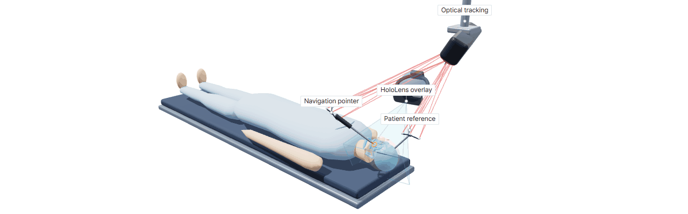</a>

### Jinmin Kim — Robotics & Computer Vision R&D Engineer

DIGITRACK Inc. · M.S. Robotics & Mechatronics Engineering, DGIST 
Optical tracking · 3D registration · Surgical navigation · XR · Robot and vision integration

   · [한국어 포트폴리오](https://rafaam11.github.io/)

## Projects

Each image is a 3D figure from the portfolio; open a case to rotate it.

| | Project | Tools |
|:---:|:---|:---|
| <a href="https://rafaam11.github.io/en/projects/surgical-navigation/">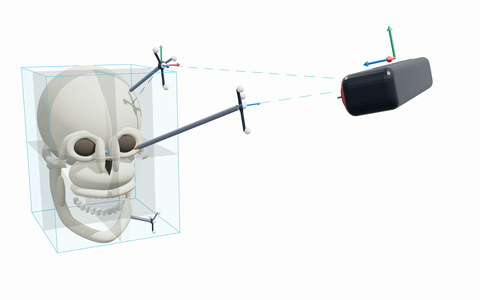</a> | **[SMCNavi · HoloLens Surgical Navigation](https://rafaam11.github.io/en/projects/surgical-navigation/)** 2023.07 – present · Prototype Designed the architecture and, as effectively the sole developer, implemented imaging, optical tracking, registration, calibration and HoloLens integration; phantom-tested. |   HoloLens 2 · MRTK · OpenIGTLink |
| <a href="https://rafaam11.github.io/en/projects/digital-occlusion-workflow/">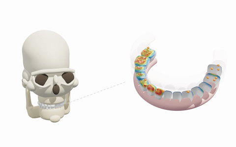</a> | **[Maxillofacial Digital Occlusion Workflow](https://rafaam11.github.io/en/projects/digital-occlusion-workflow/)** 2026.03 – present · Ongoing Technical lead and primary developer of the custom app: C++/Qt shell and Python modules, UI/UX, engine integration, evaluation and export, packaging. |     VTK · PyBullet · SOFA |
| <a href="https://rafaam11.github.io/en/projects/rtms-navigation/">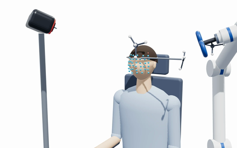</a> | **[rTMS Coil Navigation Software (NeuroPilot)](https://rafaam11.github.io/en/projects/rtms-navigation/)** 2024.07 – present · Verified Led the navigation workflow, the landmark + ICP registration engine, tracker and robot integration, and the license-gated product structure. |     VTK · TCP/IP binary protocol |
| <a href="https://rafaam11.github.io/en/projects/mandibular-fracture/">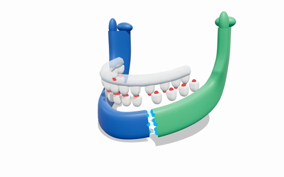</a> | **[Mandibular Fracture Reduction Optimization](https://rafaam11.github.io/en/projects/mandibular-fracture/)** 2021.12 – 2023.02 · Verified Co-first author; jointly led the simulator and optimization pipeline that sets fragment pose from dental features and fracture surfaces. |  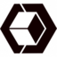    |
| <a href="https://rafaam11.github.io/en/projects/skadi-tracking-software/">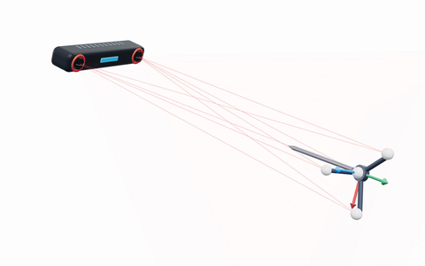</a> | **[SKADI Desktop App & API](https://rafaam11.github.io/en/projects/skadi-tracking-software/)** 2023.02 – present · Ongoing Maintain and release the optical-tracking desktop app and API: input validation, error handling, calibration tools, Python SDK and public documentation. |    SKADI |
| <a href="https://rafaam11.github.io/en/projects/respiratory-surface-guidance/">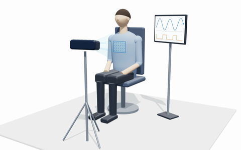</a> | **[Surface-guided Respiratory Tracking (SGRT)](https://rafaam11.github.io/en/projects/respiratory-surface-guidance/)** 2026.06 – present · Ongoing Lead sensor validation with the DtDepthScan tool I built, and develop the breathing-tracking algorithm from ROI depth to a gating signal. |    VTK · ToF · structured light |
| <a href="https://rafaam11.github.io/en/projects/life-careverse/">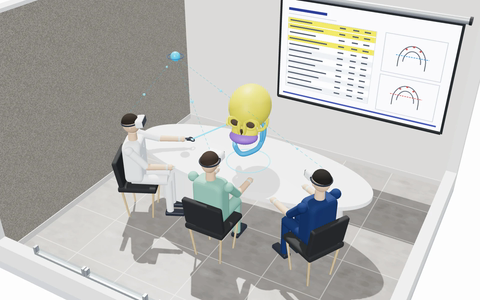</a> | **[OMFS VR — Multi-user surgical consultation](https://rafaam11.github.io/en/projects/life-careverse/)** 2023.07 – present · Ongoing Built the whole Unity client for a three-user VR consultation (rooms, sync, voice, DICOM) and ported it to OpenXR and Android XR. |     Photon PUN2 · Photon Voice · OpenXR |
| <a href="https://rafaam11.github.io/en/projects/unmanned-forklift/">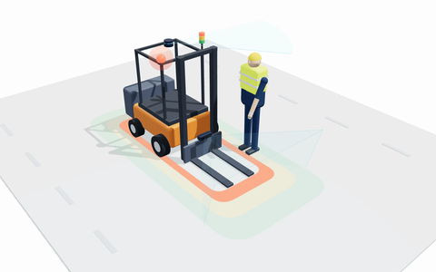</a> | **[Multi-sensor Registration for an Autonomous Forklift](https://rafaam11.github.io/en/projects/unmanned-forklift/)** 2025.11 – present · Ongoing ToF–RGB vision service, vision servoing and loading actions, LiDAR sensor integration, and the initial safety-manager design. |    BehaviorTree.CPP · SAM3 · ToF · LiDAR |
| <a href="https://rafaam11.github.io/en/projects/ai-build-lab/">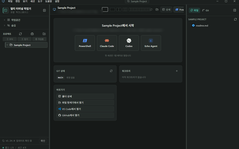</a> | **[AI Build Lab](https://rafaam11.github.io/en/projects/ai-build-lab/)** 2024 – present · Ongoing Tools I need, built and released with AI coding agents; I own the requirements, architecture, acceptance and releases. [See below.](#tools-i-build-and-use) |      |

## Tools I build and use

Desktop apps I designed and released for my own daily work, built with Claude Code and Codex.

<table>
<tr>
<td width="33%" valign="top"><a href="https://github.com/rafaam11/multi-cli-work">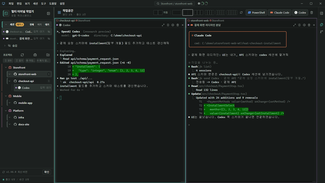</a></td>
<td width="33%" valign="top"><a href="https://github.com/rafaam11/harness-manager">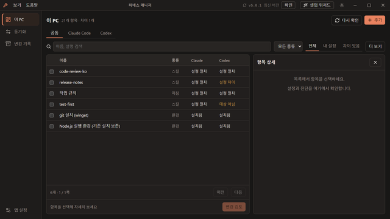</a></td>
<td width="33%" valign="top"><a href="https://github.com/rafaam11/view-anything">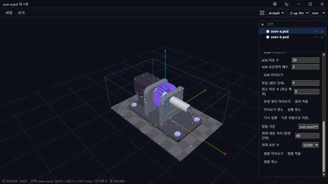</a></td>
</tr>
<tr>
<td valign="top"><b><a href="https://github.com/rafaam11/multi-cli-work">multi-cli-work</a></b> Runs Claude Code, Codex and shell sessions grouped by project folder in one window, with session status, notifications and git worktrees. </td>
<td valign="top"><b><a href="https://github.com/rafaam11/harness-manager">harness-manager</a></b> Configures and verifies the global Claude Code and Codex environments together: shared skills and instructions, settings, extensions, sync and history. </td>
<td valign="top"><b><a href="https://github.com/rafaam11/view-anything">view-anything</a></b> Double-click viewer for Markdown, PDF, data, 3D CAD and point clouds, including rigid ICP registration between two clouds. </td>
</tr>
<tr>
<td valign="top">  </td>
<td valign="top">  </td>
<td valign="top">  </td>
</tr>
</table>

## Daily tools

           

Claude Code · Codex · 3D Slicer · Open3D · OpenCV · PyTorch · ROS 2 · Zenoh · Unity · Qt · Electron · Tauri · VTK

## Selected research

**Joint first author** — [A Proof of Concept: Optimized Jawbone-Reduction Model for Mandibular Fracture Surgery](https://link.springer.com/article/10.1007/s10278-024-01014-z), *Journal of Imaging Informatics in Medicine*, 2024. DOI: [10.1007/s10278-024-01014-z](https://doi.org/10.1007/s10278-024-01014-z)

[Full publications, patents and awards — CV](https://rafaam11.github.io/en/cv/) · [Download CV (PDF)](https://rafaam11.github.io/assets/cv/jinmin-kim-cv-en.pdf)
